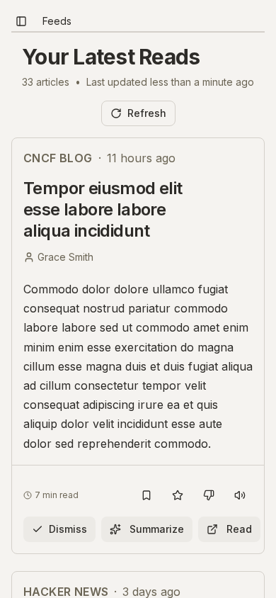
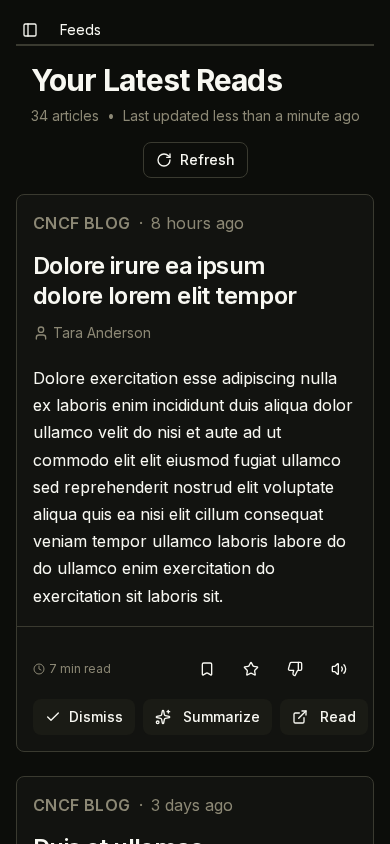
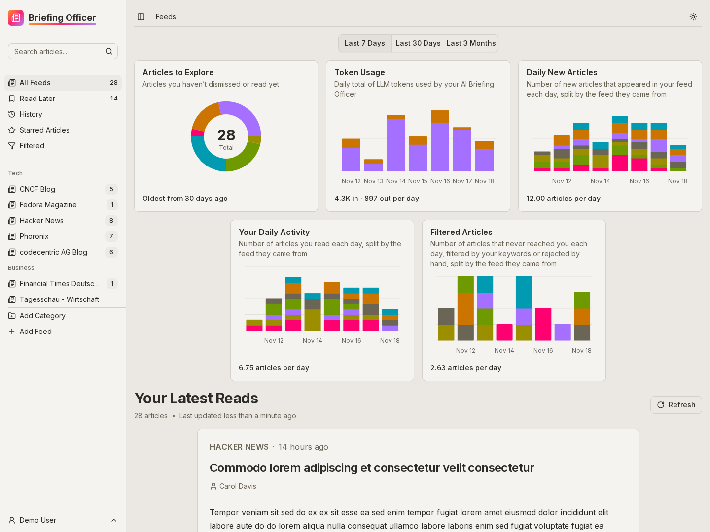
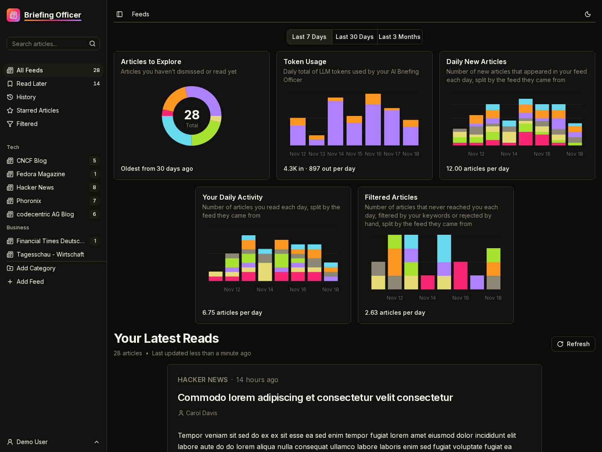

# Briefing Officer

AI briefings on your favorite news feeds.

## Screenshots

<div align="center">
  <a href="./docs/screenshots/mobile-light.png"></a>
  <a href="./docs/screenshots/mobile-dark.png"></a>
  <br/>
  <a href="./docs/screenshots/desktop-light.png"></a>
  <a href="./docs/screenshots/desktop-dark.png"></a>
</div>

## Features

- News reader with RSS and Atom support.
- Import and export your feed list as OPML.
- Three kinds of AI writing per article:
  - **Lead**: A single paragraph on what the article reports, dense enough to
    stand on its own, capped at 80 words.
  - **Text Summary**: A bullet-point list of 5–12 concise sentences with the
    article's key facts or takeaways.
  - **Audio Briefing**: A spoken briefing of roughly one minute, read aloud by
    a configured text-to-speech service or otherwise by the browser's own
    voices, at an adjustable speed, alongside a transcript that highlights each
    sentence as it is spoken.
- Chat with your articles: ask questions in plain language and get answers drawn
  only from your own feeds, with links to the articles they come from. Answers
  can be read aloud.
- Leads, text summaries and audio briefings are written in the language of the
  article itself.
- Save articles for later with "Read Later", or keep them for good with "Archive".
- Support for multiple AI providers (OpenAI, Azure OpenAI, Anthropic, and any
  OpenAI-compatible API).
- Separate accounts for every reader on one instance.
- Dark mode.
- Mobile friendly design.

## Getting Started

```bash
docker run -it --rm \
  -e DATABASE_URL=file:/data/database.sqlite \
  -e AZURE_OPENAI_RESOURCE_NAME=oai-example-dev-001 \
  -e AZURE_OPENAI_API_KEY=lorem-ipsum \
  -e BETTER_AUTH_SECRET=something-random \
  -e BETTER_AUTH_URL=http://localhost:3000 \
  -p 3000:3000 \
  ghcr.io/marcusleg/briefing-officer
```

To deploy to Kubernetes, use the Helm chart. See
[helm-chart/README.md](./helm-chart/README.md) for installation and its values.

## Configuration

### Application

| Environment Variable            | Description                                                                                                | Default |
| ------------------------------- | ---------------------------------------------------------------------------------------------------------- | ------- |
| `DATABASE_URL`                  | URL to the SQLite database.                                                                                |         |
| `FEED_REFRESH_INTERVAL_MINUTES` | Minutes between automatic feed refreshes.                                                                  | `15`    |
| `BACKGROUND_WORKER_DISABLED`    | Set to `true` to serve pages without refreshing feeds or writing leads.                                    | `false` |
| `LOG_LEVEL`                     | `trace`, `debug`, `info`, `warn`, `error` or `fatal`. `debug` logs memory usage after each background job. | `info`  |

Feeds are refreshed, articles scraped, and leads written by a background
worker inside the application process. No external cron job is needed.

### AI Providers

One provider must be configured.

| Environment Variable         | Description                                                                                                                                                                 |
| ---------------------------- | --------------------------------------------------------------------------------------------------------------------------------------------------------------------------- |
| `AI_REASONING_EFFORT`        | How much the model reasons before answering: `none`, `minimal`, `low`, `medium`, `high`, `xhigh` or `max`. Defaults to `provider-default`, which leaves it to the provider. |
| `AZURE_OPENAI_API_KEY`       | Azure OpenAI API key.                                                                                                                                                       |
| `AZURE_OPENAI_MODEL`         | Azure OpenAI model name.                                                                                                                                                    |
| `AZURE_OPENAI_RESOURCE_NAME` | Azure OpenAI resource name.                                                                                                                                                 |
| `ANTHROPIC_API_KEY`          | Anthropic API key.                                                                                                                                                          |
| `ANTHROPIC_MODEL`            | Anthropic model name.                                                                                                                                                       |
| `OPENAI_BASE_URL`            | Optional base URL for OpenAI-compatible API. Defaults to `https://api.openai.com/v1` if not set.                                                                            |
| `OPENAI_API_KEY`             | API key for OpenAI or OpenAI-compatible provider.                                                                                                                           |
| `OPENAI_MODEL`               | Model name for OpenAI or OpenAI-compatible provider.                                                                                                                        |

For OpenAI and Azure OpenAI, setting a level also tells the AI SDK to treat the
model as a reasoning model, so the level is sent even when the SDK does not
recognize the model or deployment name, and the system prompt is sent with the
`developer` role. Choose a level your model supports: depending on the provider
and model, an unsupported level is replaced by the nearest supported one,
dropped with a warning, or rejected by the API. A model that cannot reason at
all may reject any level other than `provider-default`.

### Text-to-Speech

Optional. Audio briefings are read by an OpenAI-compatible speech API when one
is configured for the article's language, and by the browser's own voices
otherwise. Chat answers are read as English, by the speech API when `en` is
among its languages. The service is used only when both `OPENAI_TTS_MODEL` and
`OPENAI_TTS_VOICE` are set. In browsers that support Media Source Extensions,
such as Firefox and Chrome, its speech keeps playing while the phone's screen
is off or another app is open; the browser's own voices usually stop there.

| Environment Variable   | Description                                                                                               |
| ---------------------- | --------------------------------------------------------------------------------------------------------- |
| `OPENAI_TTS_BASE_URL`  | Optional base URL for an OpenAI-compatible speech API. Defaults to `https://api.openai.com/v1`.           |
| `OPENAI_TTS_API_KEY`   | Optional API key for the speech API; local services often run without one.                                |
| `OPENAI_TTS_MODEL`     | Speech model name, e.g. `gpt-4o-mini-tts`.                                                                |
| `OPENAI_TTS_VOICE`     | Voice name, e.g. `alloy`.                                                                                 |
| `OPENAI_TTS_LANGUAGES` | Comma-separated ISO 639-1 codes of the article languages the voice reads, e.g. `en,de`. Defaults to `en`. |

### Authentication

| Environment Variable               | Description                                  | Default          |
| ---------------------------------- | -------------------------------------------- | ---------------- |
| `AUTH_SECRET`                      | Secret value used for encryption and hashing |                  |
| `AUTH_SELF_REGISTRATION_ENABLED`   | Allow anyone to create a new account         | `false`          |
| `BASE_URL`                         | Base URL of Briefing Officer.                |                  |
| `AUTH_GENERIC_OAUTH_ENABLE`        | Enable generic OAuth provider                | `false`          |
| `AUTH_GENERIC_OAUTH_PROVIDER_NAME` | OAuth provider name                          | `Single Sign-On` |
| `AUTH_GENERIC_OAUTH_CLIENT_ID`     | OAuth client ID                              |                  |
| `AUTH_GENERIC_OAUTH_CLIENT_SECRET` | OAuth client secret                          |                  |
| `AUTH_GENERIC_OAUTH_DISCOVERY_URL` | OAuth discovery URL                          |                  |
| `AUTH_GENERIC_OAUTH_PKCE_ENABLED`  | Enable PKCE for OAuth flow                   | `false`          |

When registering Briefing Officer with your OAuth/OIDC provider, use
`<BASE_URL>/api/auth/callback/generic` as the redirect URI.
